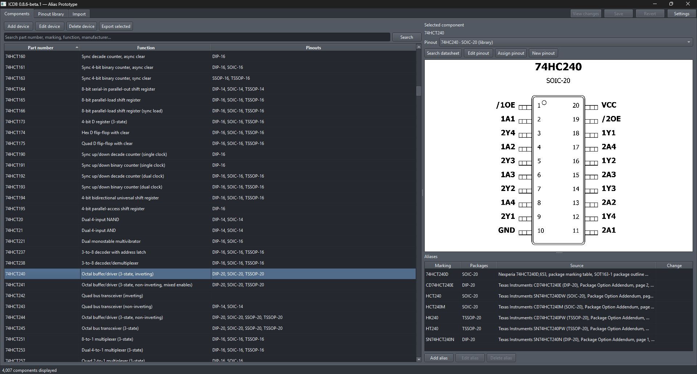
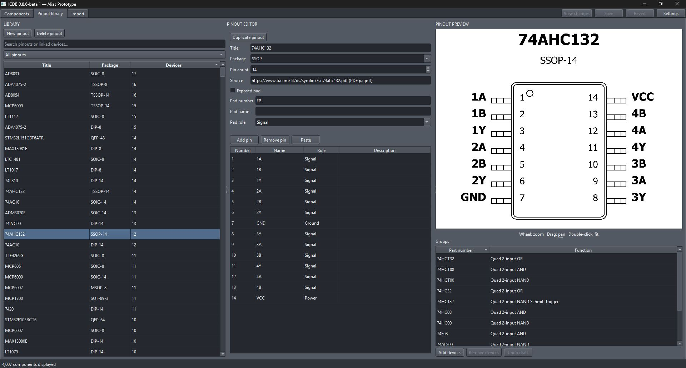

# ICDB

Component information, chip markings, and pinouts in one place.

ICDB is a Windows app for building and maintaining an electronic component catalogue. Search for a part number or the marking printed on a chip, check what the part does, and view the pinout for its package.

ICDB is the database side of ICSuite and the companion to [ICOCR](https://github.com/SpaceMonkey9000/ICOCR). ICOCR reads chip markings from a camera or photo. ICDB is where you maintain the parts, marking aliases, and pinouts behind those lookups. You can also use ICDB on its own.

The current development build is **0.8.6-beta.1**. It uses the updated Qt interface.

## Components and marking aliases

Use **Components** to search the catalogue, add or edit a device, look up a datasheet, and view its available pinouts.

A marking alias is the text printed on the chip. Use aliases to keep several verified markings under one device record. Each alias can include the packages it applies to and a source reference. For example, TI documents `MB3232I` as a marking for a package variant of the MAX3232.

Select a device and use **Add alias** in the **Aliases** panel. You can edit or delete aliases from the same panel. Once saved, a marking can be used to find the device in ICDB and resolve readings in a compatible ICOCR build. When a marking points to several devices, ICOCR lets you choose the correct one.

## Pinouts and packages

A device can have several pinouts, one for each package variant. From **Components**, you can open a linked pinout, assign an existing one, or start a new one.

The **Pinout library** shows the pin table, diagram preview, and devices that share the selected definition. Edit individual pins or paste a complete pin table. You can also record exposed-pad details and the source for a definition.

Several devices can share a definition when the physical package and pin functions agree. Check the exact device, package, and manufacturer’s datasheet before assigning a pinout.

## Importing and exporting

- **Export selected** in Components writes the selected parts to an ICDB JSON file.
- **Export all JSON** in Import writes the full catalogue. JSON exports include marking aliases and pinout assignments, with shared pinout definitions included once.
- **Choose files** in Import previews ICDB JSON batches or component CSV files. Use **Stage import**, review the preview for conflicts and unresolved links, then use **Save** to commit the staged changes. This works for transferring a group of parts or building up a new catalogue in batches.

Component, alias, and pinout edits are staged as you work. **View changes** shows what is pending, **Save** commits it, and **Revert** discards it. The status bar shows the database version separately from the application version.

## Working with ICOCR

Point both apps at the same **ICSuite DATA** folder. In ICOCR, use **Open in ICDB** to go to a recognised device or **Add to ICDB** to start a new record. You can also send a marking from ICOCR History to ICDB as an alias.

ICDB publishes changed pinout diagrams after you save. **Settings → Tools** also has controls to publish pinouts and rebuild all SVGs. Use **Reload database** in ICOCR to pick up saved catalogue and alias changes when needed.

## Getting started

Find the Windows builds and DATA package on the [Releases page](https://github.com/SpaceMonkey9000/ICDB/releases).

1. Run the ICDB installer or extract the portable build and start `ICDB.exe`. Both builds include what they need to run.
2. Install the ICSuite DATA package for the prepared catalogue and reference files. If you already use ICOCR, select the same DATA folder in **Settings → Data**.
3. To build a catalogue from scratch, point ICDB at a separate DATA folder and confirm the empty database prompt at startup.
4. Search for a part number or a saved marking to view the device and its pinouts.

The catalogue and pinout editor run locally. Datasheet searches open in your browser.

## Reporting a problem

This is a beta, and some catalogue entries still need pinouts or source checks. Include the part number, package, application version, database version, and a screenshot when opening an issue. For a marking or pinout correction, include the relevant manufacturer reference. [Open an issue](https://github.com/SpaceMonkey9000/ICDB/issues)

See the [application notes](ICDB/README.md) and [changelog](ICDB/CHANGELOG.md) for more detail.
