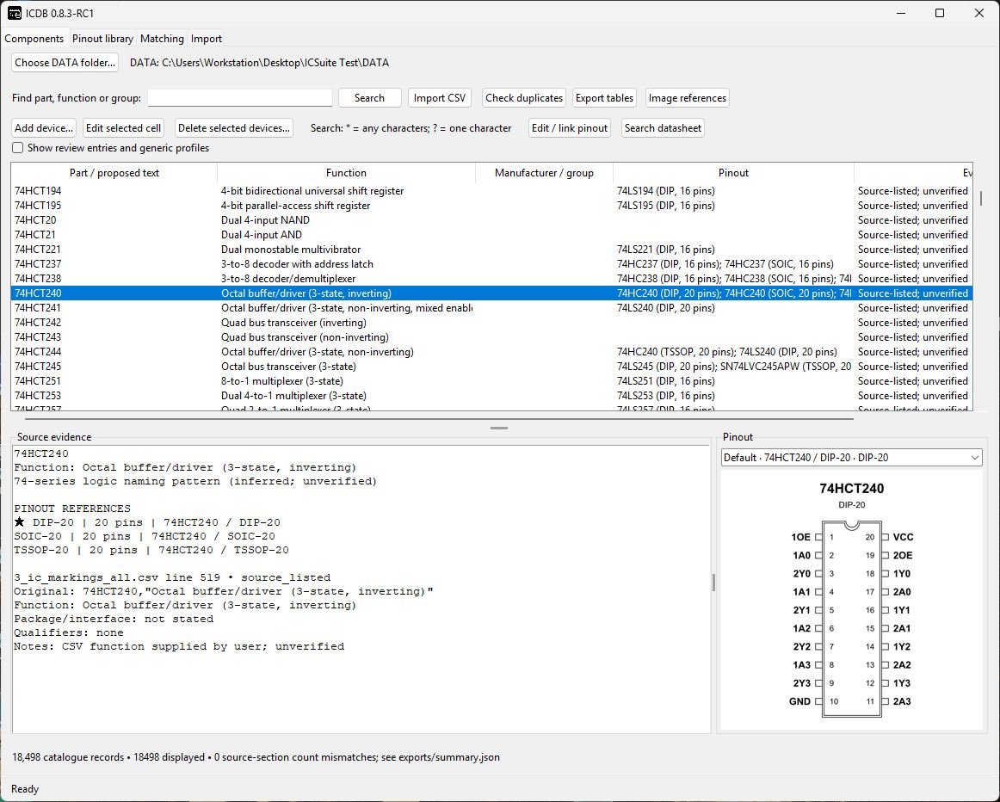
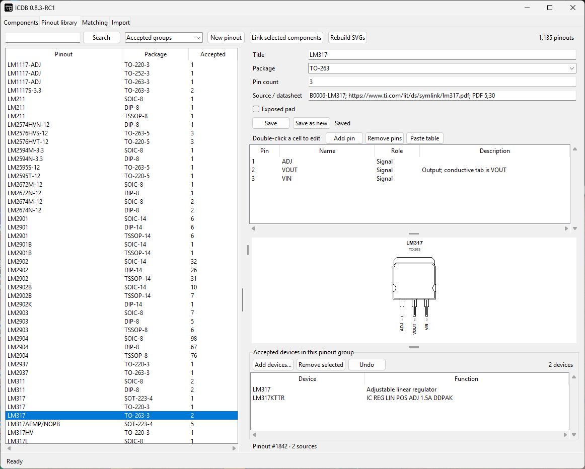

# ICDB

Component information and pinouts, in one place.

ICDB is a Windows app for browsing electronic components, keeping track of what they do, and building a library of pinout references. Search for a part, check its description, and view the available pinouts alongside it.

It’s the database side of ICSuite, and the companion to [ICOCR](https://github.com/SpaceMonkey9000/ICOCR). ICOCR reads markings from a camera or photo; ICDB is where you maintain the component information and references behind those lookups. You can also use ICDB on its own.

## What you can do

- **Find a part.** Search by part number, function, or manufacturer/group.
- **Build your own catalogue.** Add components, edit descriptions, or bring in a list from CSV.
- **Keep different packages together.** A component can have several pinout references, so its DIP, SOIC, and other versions can be kept separately.
- **Create and edit pinouts.** Enter pin numbers, names, and descriptions, with a diagram preview alongside the table.
- **Reuse a pinout.** Link several components to the same definition where their pin arrangements agree.
- **Bring in existing references.** Import supported KiCad libraries, pin tables, and other pinout sources, then review the proposed links.
- **Share references with ICOCR.** Publish the pinouts you’ve accepted so they’re available when reading chips at the bench.

## Editing a pinout

The pinout editor keeps the pin table, package preview, and linked components in the same view. You can edit individual cells or paste a whole pin table, then save it as an existing definition or a new one.

This also gives you somewhere to record package differences, exposed-pad connections, and source details instead of leaving them scattered across notes.

## Working with ICOCR

Both apps use the same **ICSuite DATA** folder. Changes to component information stay in the shared database. Pinout edits and accepted links need to be published before the updated diagrams are available to ICOCR.

Suggested matches are there to help with the lookup work. You review which pinouts belong to which parts before publishing them.

## Getting started

Download ICDB and the separate **ICSuite DATA** package from the [Releases page](https://github.com/SpaceMonkey9000/ICDB/releases). DATA provides the prepared component database and reference files.

1. Install ICDB, or extract the portable version. Python isn’t needed for either build.
2. Install ICSuite DATA if you don’t already have it.
3. Open ICDB and check that it’s using the right DATA folder, especially if you also use ICOCR.
4. Search for a component to browse its information and available pinouts.

The database and pinout editing run locally on your PC. Datasheet searches open in your web browser.

## Still a work in progress

ICDB is being developed alongside ICOCR. The catalogue and pinout library are growing, and some entries are incomplete or still need checking.

A similar part number doesn’t guarantee the same pinout. Check the exact device, package, and manufacturer’s datasheet before accepting a reference.

For the detailed editing and import workflows, see the [application notes](ICDB/README.md). Changes are listed in the [changelog](ICDB/CHANGELOG.md).

## Reporting a problem

An [issue](https://github.com/SpaceMonkey9000/ICDB/issues) with the part number, package, application version, and a screenshot helps explain what went wrong. For a pinout correction, include the relevant datasheet or source reference.
